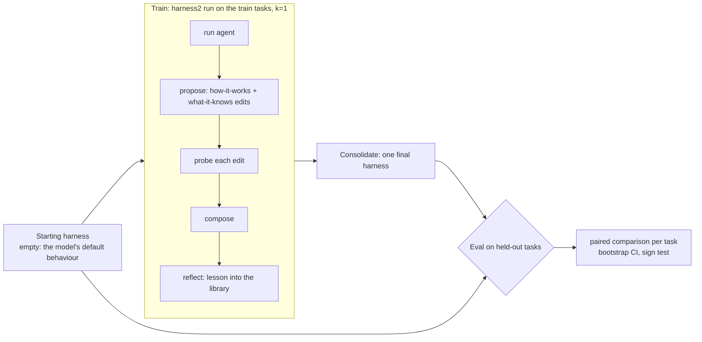

# Does Harness² make agents better on tasks it hasn't seen?

Five pre-registered experiments that put [Harness²](https://arxiv.org/abs/2610.14224) (Google,
Oct 2026) to one test: let it refine an agent's **harness** — the instructions, skills, scripts and
hooks around a frozen model — on a few tasks, then measure the same model with the old and the new
harness on **held-out** tasks it never saw. Everything runs on GitHub Actions against the
Anthropic API, with hard spending caps (≈ $100 in total).

## Results

<!-- results:start -->
| # | Experiment | Held-out tasks | Base | Harness² | Δ (95% CI) | Verdict | Spend |
|---|---|---|---|---|---|---|---|
| 1 | [Harvey LAB — drafting a fund LPA from a precedent](results/e1-lab-lpa/README.md) | –×1 | – | – | – | not run yet | $0.49 / $22.5 |
| 2 | [τ³-bench banking_knowledge — customer service over a knowledge base](results/e2-tau-banking/README.md) | –×2 | – | – | – | not run yet | $0.04 / $16.5 |
| 3 | [τ²-bench airline — customer service](results/e3-tau-airline/README.md) | –×3 | – | – | – | not run yet | $0.02 / $15.5 |
| 4 | [Terminal-Bench 2.0 — terminal tasks in containers](results/e4-terminal-bench/README.md) | –×1 | – | – | – | not run yet | $0.01 / $22 |
| 5 | [SWE-bench Pro (openlibrary) — repository issues](results/e5-swe-pro/README.md) | –×1 | – | – | – | not run yet | $0.01 / $23.5 |

_Last updated 2026-10-27 15:10 UTC._
<!-- results:end -->

Δ is in percentage points, final harness minus starting harness, averaged over held-out tasks;
the CI is a bootstrap over tasks. "Improved" means the whole CI is above zero. Per-experiment pages
show per-task results, pass^k, the harness Harness² wrote, and the improver's notes.

## The five experiments

| | Benchmark | Agent being improved | What Harness² may edit | Train → test | Metric |
|---|---|---|---|---|---|
| e1 | [Harvey LAB](https://github.com/harveyai/harvey-labs) `draft-lpa`: draft a fund's limited-partnership agreement from a precedent, a term sheet and instructions | Claude Code + Haiku 5.5, files workspace | `CLAUDE.md`, skills, subagents, scripts, hooks | 3 → 6 matters (different funds) | share of LAB rubric criteria met |
| e2 | [τ³-bench](https://github.com/sierra-research/tau2-bench) `banking_knowledge`: customer service where answers live in a 698-document knowledge base (BM25 search) | tau2's own `llm_agent` + Haiku 5.5 | `AGENT.md` (system prompt) + `guides/*.md` read on demand | 3 → 24 conversations ×2 | tau2 reward (database end state) |
| e3 | [τ²-bench](https://github.com/sierra-research/tau2-bench) `airline` | tau2's own `llm_agent` + Haiku 5.5 | `AGENT.md` + `guides/*.md` | 3 (official train split) → 20 (official test split) ×3 | tau2 reward, pass^1–3 |
| e4 | [Terminal-Bench 2.0](https://github.com/laude-institute/terminal-bench-2) via [Harbor](https://github.com/laude-institute/harbor) | Claude Code + Haiku 5.5 in the task container | `CLAUDE.md`, skills, subagents, scripts, hooks | 3 → 12 tasks | task tests pass |
| e5 | [SWE-bench Pro](https://scale.com/research/swe_bench_pro) (public), `internetarchive/openlibrary` only, via Harbor | Claude Code + Haiku 5.5 in the repo container | same | 3 → 10 issues | fail-to-pass + pass-to-pass tests |

Why these: they are where agents are already deployed (customer service, legal drafting, terminal
work, repository maintenance) and where a mid-tier model sits in the middle of the score range —
room to improve, not hopeless. Why one repository in e5 and one task family in e1: a harness can
carry *domain* knowledge (a codebase's layout and test commands; how an LPA precedent must be
adapted) from training tasks to new ones, which is the transfer Harness² claims.

## Protocol



1. **Pre-registration.** `experiments/<id>/tasks.lock.json` fixes the train and test tasks before any
   model call ([`scripts/select_tasks.py`](scripts/select_tasks.py): seeded shuffles of filtered
   pools from pinned benchmark commits). τ² airline uses tau2's official train/test split. In e1 the
   two variants of each fund are grouped so they never straddle train and test.
2. **Train** (`h2x train`): the pinned [Harness² CLI fork](https://github.com/3ae3ae/harness2-cli)
   runs the paper's method on the train tasks — per task, run the agent, propose edits along the two
   dimensions (how the agent works / what a practitioner knows), probe each, compose, reflect into a
   per-domain library — then consolidates **one final harness**. The improver is Claude Sonnet 5.5;
   the agent's weights never change.
3. **Grades are hidden from the method.** Runners write rewards to `.h2x_hidden/`, outside every
   rollout directory, and the adapters render evidence only from fixed agent-visible files; a CI test
   checks that no grade string reaches anything the improver read.
4. **Eval** (`h2x eval`): every (test task, repeat) is run once with the starting harness and once
   with the final harness, on the same machine, with the same seed index. Rollouts that failed for
   infrastructure reasons are re-run or excluded — never scored as zeros.
5. **Report** (`h2x report`): per-task means per arm, mean paired difference with a 10,000-sample
   bootstrap CI over tasks, an exact sign test, and τ's pass^k. The in-task numbers (each train
   task's adopted rollout vs its base rollout — the paper's own protocol) are reported alongside but
   are not the headline: they don't test transfer.

The starting harness is **empty** in every experiment, so the baseline is exactly the stock agent
(tau2's `llm_agent`, Harbor's `claude-code`, plain Claude Code).

## Run it

1. **Add the API key**: Settings → Secrets and variables → Actions → *New repository secret* →
   `ANTHROPIC_API_KEY`. Recommended: also set a monthly spend limit for that key's workspace in the
   [Anthropic Console](https://console.anthropic.com) as a backstop. Optional: `DOCKERHUB_USERNAME`
   and `DOCKERHUB_TOKEN` to avoid anonymous Docker Hub pull limits (e4/e5).
2. **Smoke test everything** (≈ $1–3): Actions → **smoke-all** → Run workflow → tick
   *confirm_spend*. Each experiment runs one real base-harness rollout, grades it, and records its
   cost in `results/<id>/smoke.json`.
3. **Pilot**: Actions → **experiment** → `e3-tau-airline`, phase `all`, tick *confirm_spend*. It's the
   cheapest and fastest; compare its real spend with `h2x plan e3-tau-airline` before running the rest.
4. **The rest**: same workflow for `e2`, `e1`, `e4`, `e5` (phase `all`). Every phase resumes, so if a
   job stops (6-hour Actions limit, budget cap, API outage), run the same phase again.
5. **Read results** in the table above, in `results/<id>/README.md`, or on a dashboard: Settings →
   Pages → *Deploy from a branch* → `main` / `/docs`.

Locally (with Docker for e4/e5): `pip install -r requirements/core.txt -e .`, plus the family's
requirements, then `h2x plan|smoke|train|eval|report <id>`. Offline tests:
`python -m unittest discover -s tests -t .`

## Money

| | train cap | eval cap | total |
|---|---|---|---|
| e1 LAB | $14.5 | $7 | $22.5 |
| e2 τ³ banking | $10 | $6 | $16.5 |
| e3 τ² airline | $10 | $5 | $15.5 |
| e4 Terminal-Bench | $13 | $8.5 | $22 |
| e5 SWE-bench Pro | $14 | $9 | $23.5 |
| **all** | | | **$100** |

Prices used for accounting (per MTok): Haiku 5.5 $0.10 in / $0.50 out ($0.50 / $2.50 for a request
whose prompt exceeds 100K tokens), Sonnet 5.5 $2 / $10, cache reads 5–10% of input
([pricing](https://platform.claude.com/docs/en/about-claude/pricing), checked 2026-10-27). Guards, from
outermost in: the per-experiment cap in `results/<id>/spend.json` (checked before every phase),
Harness²'s `--budget-usd` on training, a per-shard cap on eval, Claude Code's `--max-budget-usd` on
every improver session ($3) and agent rollout ($1–2), and tau2/Harbor step and time limits. A call
already in flight when a cap is reached still finishes, so a phase can overshoot by a few rollouts.

## Choices and deviations, stated up front

- **Models.** The agent is Claude Haiku 5.5 — the cheapest current model, and one that leaves room to
  improve. The improver is Sonnet 5.5 at high effort. Haiku 5.5 is also τ's simulated customer, so
  τ numbers are not comparable to the public leaderboard (tau2's default simulator is GPT-4.1); both arms share
  the same simulator, so the comparison is fair.
- **No sampling parameters.** Claude 5.5 models reject non-default `temperature`/`top_p`, so tau2's
  default `temperature=0` is not sent, and LAB's judge is called without it. Runs are therefore not
  deterministic; repeats (e2, e3) and paired arms absorb some of that.
- **τ communicate check.** tau2 v2.0.0 grades "communicated the required info" with a GPT-5.5 judge
  by default; this needs an OpenAI key, so the original substring matcher is used (6 of 50 airline
  tasks have such info; banking has none).
- **τ harness surface.** tau2's agent is a prompt + tool loop, so Harness² edits `AGENT.md` (appended
  to the system prompt) and `guides/<name>.md` (listed by first line, read through an `open_guide`
  tool the agent answers locally). Harness² sees this as its generic "command" surface.
- **LAB judge.** LAB's own prompt, document extraction and per-criterion scoping, but Claude Haiku
  5.5 instead of Sonnet 4.6 (≈ 30× cheaper at ~100 criteria per matter), with the shared prompt
  prefix cached. Both arms share the judge. LAB's LLM fallback for misnamed output files is off.
- **Harbor harness install.** The harness is copied into the container's working directory for the
  agent run and removed (originals restored) before the tests run; the repository diff is captured
  for the improver to read.
- **Transfer eval is h2x's own.** The fork's `harness2 eval` only re-runs tasks that were in the
  training stream, so it can't test held-out tasks; `h2x eval` reuses the same adapters to do that.
- **k = 1, parallel mode only**, the cheapest setting of the method. The paper's larger-k results
  may not carry over to k = 1.

## Limits worth keeping in mind

Samples are small (6–24 held-out tasks), so only large effects will reach significance; a "no clear
difference" verdict is not evidence of no effect. Each experiment trains once (one seed), and the
train sets are 3 tasks. LAB grades come from an LLM judge. The harness the improver writes runs
with `--dangerously-skip-permissions` — on ephemeral Actions runners for e1, inside task containers
for e4/e5 — and may contain hooks and scripts.

## Layout

```
experiments/<id>/      experiment.toml (question, models, caps), tasks.lock.json, .harness2/config.toml,
                       harness/ (the empty starting harness)
h2x/suites/            Harness2 suite adapters: tau (tau2-bench), harbor (TB2, SWE-bench Pro), lab (LAB)
h2x/tau_runner/        one tau2 conversation with a harness (agent, transcript, hidden reward)
h2x/harbor_runner/     one Harbor trial with Claude Code + harness (install/remove, diff, hidden reward)
h2x/lab/               LAB task import and rubric grading
h2x/{train,evalx,report,stats,ledger}.py   the phases, statistics and spend ledger
results/<id>/          committed outputs: summary, final harness + diff + notes, per-task adopted diffs
.github/workflows/     ci (offline), experiment (one experiment, any phase), smoke-all
```

Third-party code and data are fetched at pinned commits at run time; see [NOTICE](NOTICE).
